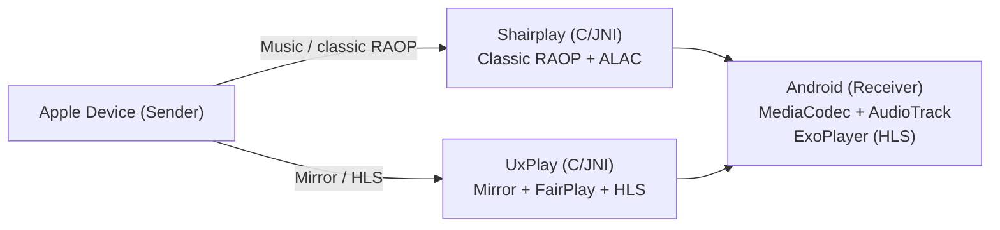

# Sonic Cast TV

Sonic Cast TV is a music-first Android TV AirPlay receiver. This customized build
adds a living-room Now Playing interface, cover art, real track metadata, remote
transport controls, synchronized lyrics from LRCLIB, and a CD-quality status
display. Its default receiver name is
`Sonic Cast TV`; audio advertising and the software ALAC decoder are enabled by
default, while video advertising is disabled for a focused music experience.

Version 0.5.0 adds a dedicated classic RAOP speaker engine based on
[Shairplay](https://github.com/juhovh/shairplay). The default music-only mode
now accepts the protocol used by the Music app on current macOS releases and
decodes its ALAC stream to 16-bit/44.1 kHz stereo PCM. Artwork, metadata,
progress, DACP controls, background playback, and synchronized lyrics remain
connected to the TV Now Playing experience.

Version 0.4.0 added a dedicated ten-foot Android TV interface with a left-side
remote-control navigation rail, large receiver cards, a two-column TV settings
screen, TV diagnostics, and an immersive full-screen Now Playing layout.

For music-only operation, Sonic Cast advertises a classic `_raop._tcp` speaker
profile and runs the matching receiver protocol. It no longer presents itself
as an `_airplay._tcp` Apple TV unless video advertising is explicitly enabled.
Turning video advertising on switches back to UxPlay for mirroring and HLS.

Version 0.3.0 introduced a sticky foreground media service when
background mode is enabled (the default). Pressing Home during music playback no
longer opens Picture-in-Picture; audio and system media controls remain active in
the background. Lyrics are fetched from `https://lrclib.net` using the track title,
artist, album and duration supplied by the AirPlay sender. No account or API key
is used, no lyrics are bundled with the application, and availability varies by
track.

This project is a GPL-3.0 derivative of
[jqssun/android-airplay-server](https://github.com/jqssun/android-airplay-server),
based on upstream version 0.0.23 (commit
`70c414ade84fbc3715a58d4c299687bca99c4dfe`). The bundled native Android
libraries were taken from that matching upstream release and their corresponding
source is included under `app/src/main/cpp`. See [NOTICE.md](NOTICE.md) for
attribution and build details.

## Sonic Cast build

The supplied Gradle configuration packages native libraries from
`app/src/main/jniLibs`. The classic receiver can be rebuilt with Android NDK
r27c using `app/src/main/cpp/classic/CMakeLists.txt`; its complete Shairplay
source and license are retained under `app/src/main/cpp/third_party/shairplay`.
The UxPlay libraries match the upstream 0.0.23 Android release.

---

# AirPlay Receiver for Android (upstream documentation)

[](https://github.com/jqssun/android-airplay-server)
[](https://github.com/jqssun/android-airplay-server/releases)
[](https://github.com/jqssun/android-airplay-server/blob/main/LICENSE)
[](https://github.com/jqssun/android-airplay-server/actions/workflows/apk.yml)
[](https://github.com/jqssun/android-airplay-server/releases)

A fully featured free and open-source implementation of AirPlay for Android that turns your device into an AirPlay-compatible display and speaker, based on [UxPlay](https://github.com/FDH2/UxPlay). It is the first open-source AirPlay 2 receiver for Android and Android TV, and works with iOS/iPadOS, macOS devices as well as other sender implementations.

[](https://play.google.com/store/apps/details?id=io.github.jqssun.airplay)
[](https://f-droid.org/packages/io.github.jqssun.airplay)
[](https://github.com/jqssun/android-airplay-server/releases/latest)

<video loop src='https://github.com/user-attachments/assets/79ed7c0c-0102-43cc-8816-4f00ce6a4199' alt="demo" width="200" style="display: block; margin: auto;"></video>

## Compatibility

- Android 7.0+, including Android TV
- AirPlay devices on the same subnet, including iOS/iPadOS, macOS devices, or other sender implementations

## Features

- Screen mirroring with H.264 and H.265 (HEVC) video decoding
- Audio streaming with AAC-ELD, AAC-LC and ALAC audio decoding
- Video playback with support for HLS, downloads, and remote controls
- Music playback with track information, cover art, and remote controls
- Support for Android TV with directional pad navigation and seeking controls
- Support for Picture-in-Picture, automatic resolution and mode switching
- Optional PIN authentication
- Video resolution, overscan, and frame rate control
- Audio latency control and support for software decoder fallback
- Debug overlay with real-time statistics (FPS, bitrate, codec, resolution, frame count, audio volume, etc.)
- Android native media session integration with notification controls

> [!WARNING]
> DRM content (e.g. from the Apple TV application) is not supported.

## Implementation

This application uses [Shairplay](https://github.com/juhovh/shairplay) for the default classic AirPlay music-speaker route and [UxPlay](https://github.com/FDH2/UxPlay) when video advertising is enabled. Both are connected to Android through JNI. Audio is rendered with AudioTrack or decoded via MediaCodec/the Apple ALAC software fallback, while mirroring video is decoded via MediaCodec and rendered to a SurfaceView. HLS sessions are served through a local playlist proxy.



CMake is used for native C/C++ components under [`app/src/main/cpp`](app/src/main/cpp). Submodules must be initialized before building. 

```bash
git submodule update --init --recursive
./gradlew assembleDebug
```

Check out the [CI](https://github.com/jqssun/android-airplay-server/blob/main/.github/workflows/apk.yml) for more details on reproducible builds.

## Credits

- [UxPlay](https://github.com/FDH2/UxPlay) for the AirPlay/RAOP server implementation
- [Shairplay](https://github.com/juhovh/shairplay) for the classic RAOP speaker implementation
- [ALAC](https://github.com/macosforge/alac) for the lossless audio decoder
- [Next Player](https://github.com/anilbeesetti/nextplayer) for the video player

---

Disclaimer: This project is not affiliated with Apple Inc.
