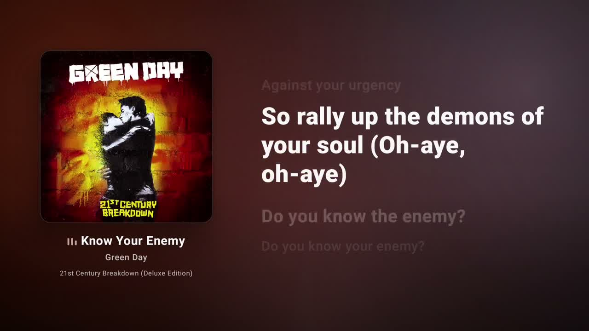

# Sonic Cast TV

<p align="center">
  <strong>AirPlay music receiver สำหรับ Android TV พร้อมปกเคลื่อนไหวและเนื้อเพลงแบบคำต่อคำ</strong>
</p>

<p align="center">
  
  
  
  
</p>

Sonic Cast TV เปลี่ยน Android TV ให้เป็นลำโพง AirPlay สำหรับฟังเพลงในห้องนั่งเล่น รองรับเสียง ALAC ระดับ CD Quality, ข้อมูลเพลงและปกอัลบั้ม, รีโมตควบคุมการเล่น, ปกเคลื่อนไหวจาก Apple Music และเนื้อเพลงที่ไฮไลต์ตามเวลาแบบ Word-by-Word บนอินเทอร์เฟซที่ออกแบบสำหรับจอ 1920×1080 และรีโมต D-pad โดยเฉพาะ

## วิดีโอสาธิต

<p align="center">
  <a href="docs/media/SonicCastTV-demo.mp4">
    
  </a>
</p>

<p align="center">
  <a href="docs/media/SonicCastTV-demo.mp4"><strong>▶ เปิดวิดีโอสาธิต 1080p ความยาว 15 วินาที</strong></a>
</p>

> วิดีโอนี้บันทึกจาก Android TV จริงที่ 1920×1080, 59.94 FPS และไม่มีเสียง

## จุดเด่น

- **AirPlay Music Receiver** — โหมดลำโพง RAOP ที่ทำงานร่วมกับ Music บน iPhone, iPad และ macOS
- **CD Quality Audio** — รับและถอดรหัส ALAC เป็น PCM สเตอริโอ 16-bit / 44.1 kHz
- **ออกแบบเพื่อทีวีจริง** — ตัวอักษรและระยะห่างสำหรับการมองจากระยะไกล พร้อมการควบคุมด้วย D-pad
- **Dynamic Artwork Background** — ผสมสีพื้นหลังจากปกอัลบั้มและเคลื่อนไหวด้วย GPU
- **Apple Music Motion Artwork** — ค้นหาและเล่นปกวิดีโอ HLS แบบวนเมื่ออัลบั้มนั้นรองรับ
- **Static Cover Companion** — โหลดปกนิ่ง 1200×1200 คู่กับปกเคลื่อนไหวเพื่อสร้างสีพื้นหลังให้ตรงกับอัลบั้ม
- **Word-by-Word Lyrics** — ใช้เวลาระดับคำ/พยางค์เมื่อมีข้อมูล และประเมินช่วงคำอัตโนมัติเมื่อมีเพียงเวลาระดับบรรทัด
- **Display-synced Lyrics** — การไฮไลต์เนื้อเพลงเดินตามเฟรมจอ 59.94/60 Hz
- **Minimal Now Playing UI** — ซ่อนตัวควบคุมอัตโนมัติและจัดปก/เนื้อเพลงกลับสู่กึ่งกลางจออย่างนุ่มนวล
- **Animated Playing Indicator** — แท่งเสียงเคลื่อนไหวข้างชื่อเพลงโดยไม่เพิ่มภาระการจัดวาง UI
- **Background Playback** — เล่นเสียงต่อเมื่อกด Home พร้อม Media Session และการแจ้งเตือนควบคุมเพลง
- **DACP Controls** — เล่น/หยุด, เพลงก่อนหน้า/ถัดไป, ปรับเสียง และปิดเสียงจากหน้า TV
- **Optional Video Mode** — สามารถเปิดการโฆษณา AirPlay Display สำหรับ Mirroring/HLS ได้จากการตั้งค่า

## ความต้องการของระบบ

- Android 7.0 (API 24) ขึ้นไป
- Android TV หรือกล่อง Android ที่มีจอและระบบเสียง
- อุปกรณ์ส่งและ Android TV อยู่ในเครือข่าย Wi-Fi/LAN เดียวกัน
- แนะนำจอ 1920×1080 ที่ 60 Hz

## การติดตั้ง

ดาวน์โหลด APK จากหน้า **Releases** ของโปรเจกต์ แล้วติดตั้งด้วย USB, แอพจัดการไฟล์ หรือ ADB:

```bash
adb connect <ANDROID_TV_IP>:5555
adb install -r SonicCastTV.apk
```

หลังติดตั้ง แอพจะปรากฏในหน้า Apps ของ Android TV ในชื่อ **Sonic Cast TV**

## วิธีใช้งาน

1. เปิด Sonic Cast TV และตรวจว่าสถานะเป็น `LISTENING FOR AIRPLAY`
2. เชื่อมต่อ iPhone, iPad หรือ Mac กับเครือข่ายเดียวกับทีวี
3. เปิด Music หรือ Control Center แล้วเลือกอุปกรณ์ AirPlay ชื่อ `Sonic Cast TV`
4. เริ่มเล่นเพลง ปกอัลบั้ม เนื้อเพลง และสีพื้นหลังจะแสดงโดยอัตโนมัติ
5. ใช้รีโมต TV เพื่อเรียกตัวควบคุมขึ้นมา หรือปล่อยไว้ให้ซ่อนอัตโนมัติ

ชื่ออุปกรณ์, การเริ่มเซิร์ฟเวอร์อัตโนมัติ, การเล่นพื้นหลัง และโหมดวิดีโอสามารถเปลี่ยนได้จากหน้า **Settings**

## แหล่งข้อมูลเนื้อเพลงและปกเคลื่อนไหว

แอพไม่ฝังเนื้อเพลงหรือปกเคลื่อนไหวไว้ใน APK แต่ค้นหาเมื่อเริ่มเล่นเพลง:

- [LyricsPlus](https://github.com/ibratabian17/lyricsplus) — แหล่งข้อมูลหลักสำหรับเวลาแบบคำ/พยางค์
- [LRCLIB](https://lrclib.net) — แหล่งสำรองสำหรับเนื้อเพลงแบบซิงก์และเนื้อเพลงธรรมดา
- [iTunes Search API](https://performance-partners.apple.com/search-api) — ระบุอัลบั้มและปกนิ่งที่ตรงกับเพลง
- Apple Music public album pages/CDN — ตรวจและสตรีมปกเคลื่อนไหวเมื่อมีให้ใช้งาน

แอพส่งเฉพาะชื่อเพลง ศิลปิน อัลบั้ม และระยะเวลาเพื่อค้นหารายการที่ตรงกัน ไม่ต้องเข้าสู่ระบบ ไม่มีระบบวิเคราะห์พฤติกรรม และไม่บันทึกเนื้อเพลงหรือไฟล์ปกจากบริการเหล่านี้ลงเครื่องอย่างถาวร

## การ Build

ต้องใช้ Java 17 และ Android SDK 36:

```bash
./gradlew testDebugUnitTest
./gradlew assembleDebug
```

APK ที่สร้างเสร็จจะอยู่ที่:

```text
app/build/outputs/apk/debug/app-debug.apk
```

โปรเจกต์มี native libraries สำหรับ `armeabi-v7a`, `arm64-v8a` และ `x86_64` รวมอยู่แล้ว ส่วนซอร์สของตัวรับสัญญาณและตัวถอดรหัสอยู่ใน `app/src/main/cpp`

## โครงสร้างส่วนสำคัญ

```text
app/src/main/kotlin/io/github/jqssun/airplay/
├── artwork/     # ปกนิ่งและ Apple Music motion artwork
├── audio/       # Metadata, DACP และสถานะเสียง
├── lyrics/      # LyricsPlus, LRCLIB และ word timing
├── renderer/    # ตัวเล่นวิดีโอและ audio/video pipeline
├── service/     # Foreground AirPlay service
└── ui/          # Compose UI สำหรับโทรศัพท์และ Android TV
```

## ข้อจำกัด

- ไม่รองรับเนื้อหา DRM เช่นวิดีโอที่ป้องกันด้วย FairPlay
- ปกเคลื่อนไหวและเนื้อเพลงขึ้นอยู่กับข้อมูลที่ผู้ให้บริการมีสำหรับแต่ละเพลง
- โครงสร้างหน้า Apple Music หรือ API ภายนอกอาจเปลี่ยนแปลงได้ในอนาคต
- ความเข้ากันได้และ latency อาจแตกต่างตามอุปกรณ์ส่ง, Android TV และคุณภาพเครือข่าย

## Open-source และเครดิต

Sonic Cast TV เป็นงานดัดแปลงภายใต้ GPL-3.0 จาก [jqssun/android-airplay-server](https://github.com/jqssun/android-airplay-server) รุ่น 0.0.23 และใช้ส่วนประกอบโอเพนซอร์สดังต่อไปนี้:

- [Shairplay](https://github.com/juhovh/shairplay) — classic RAOP music receiver
- [UxPlay](https://github.com/FDH2/UxPlay) — AirPlay mirroring และ HLS receiver
- [Apple ALAC](https://github.com/macosforge/alac) — lossless audio decoder
- [Media3](https://github.com/androidx/media) — HLS motion-artwork playback
- [AdvancedRPC](https://github.com/down-bad/advanced-rpc) — แรงบันดาลใจสำหรับ animated-artwork fallback

รายละเอียดซอร์สและสัญญาอนุญาตเพิ่มเติมอยู่ใน [NOTICE.md](NOTICE.md) และ [LICENSE](LICENSE)

## License

โปรเจกต์นี้เผยแพร่ภายใต้ [GNU General Public License v3.0](LICENSE)

Sonic Cast TV ไม่มีความเกี่ยวข้องหรือได้รับการรับรองจาก Apple Inc. คำว่า AirPlay และ Apple Music เป็นเครื่องหมายการค้าของ Apple Inc.
